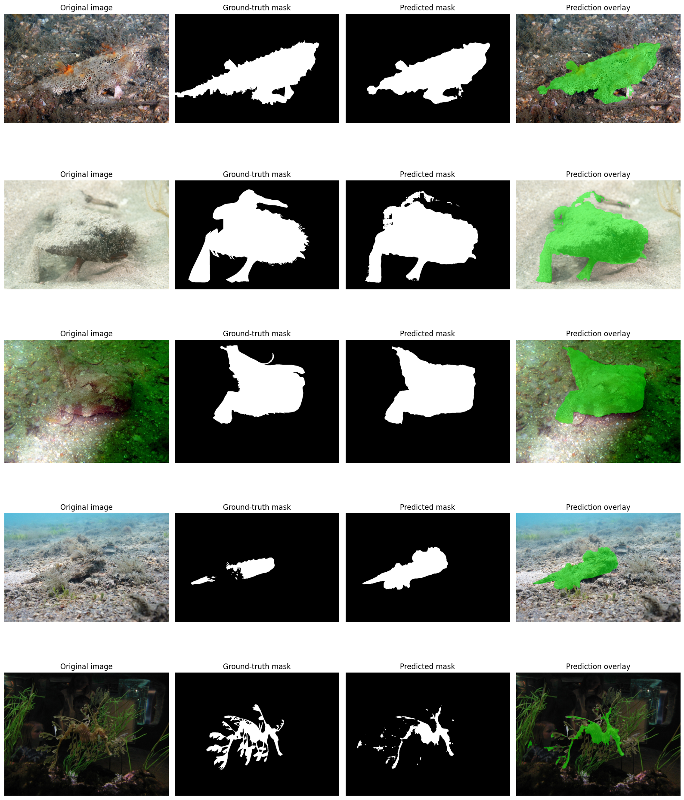

# Camouflaged Object Detection with SAM ViT-B on COD10K

A student research project exploring **camouflaged object detection (COD)** with the Segment Anything Model (SAM), ViT-B, and the COD10K dataset.

> **Main project / final approach:** [\`05_sam_vit_b_cod10k_final_training.ipynb\`](05_sam_vit_b_cod10k_final_training.ipynb)  
> This is the primary notebook for the project. It contains the full SAM ViT-B fine-tuning workflow and the final reported evaluation. Notebooks 01–04 document earlier experiments and exploratory attempts; they are retained for transparency and project history, but they are **not the final method** and should not be treated as equally mature or directly comparable final results.

## Start here

If you want to understand or reproduce the main project, start with **Notebook 05**. The earlier notebooks show how the approach evolved.

| Notebook | Role in the project |
|---|---|
| [01 — SAM COD baseline](01_sam_cod_baseline.ipynb) | Initial baseline attempt; exploratory |
| [02 — Edge-aware SAM experiments](02_edge_aware_sam_experiments.ipynb) | Early edge-aware experiments; exploratory |
| [03 — Self-prompting and post-processing](03_self_prompting_and_postprocessing.ipynb) | Experiments with prompting and inference-time post-processing; exploratory |
| [04 — Edge Pyramid and threshold ablation](04_edge_pyramid_and_threshold_ablation.ipynb) | Further edge/threshold experiments; exploratory |
| **[05 — Final SAM ViT-B training](05_sam_vit_b_cod10k_final_training.ipynb)** | **Primary notebook: full-model fine-tuning and final reported evaluation** |

The earlier approaches did not consistently improve the results across metrics. They are included as experimental history rather than presented as successful final solutions.

## Main approach overview

The final workflow uses SAM ViT-B as the segmentation foundation and fine-tunes it for camouflaged-object masks from COD10K.

\`\`\`mermaid
flowchart TD
    A[COD10K images and ground-truth masks] --> B[Preprocessing and data splits]
    B --> C[SAM ViT-B initialization]
    C --> D[Full SAM ViT-B fine-tuning]
    D --> E[Epoch checkpoint evaluation]
    E --> F[Predicted segmentation masks]
    F --> G[Evaluation: S-measure, E-measure, weighted F, MAE, IoU, Dice]
\`\`\`

The diagram describes the **final notebook's workflow**, not the sequence of every exploratory experiment.

## Qualitative predictions

The following figure is extracted from the saved output of the final-training notebook.

Additional notebook-derived figures:
- [Dataset sample](cod10k_figures_and_results/figures/01_cod10k_dataset_sample.png)
- [Baseline prediction example](cod10k_figures_and_results/figures/02_baseline_prediction_example.png)
- [Epoch prediction comparison](cod10k_figures_and_results/figures/03_epoch_prediction_comparison.png)
- [Epoch 4 vs. epoch 5 comparison](cod10k_figures_and_results/figures/04_qualitative_epoch4_vs_epoch5.png)
- [Original-resolution prediction examples](cod10k_figures_and_results/figures/06_original_resolution_prediction_examples.png)

## Final notebook: reported evaluation

The final-training notebook records the following test evaluation for the **epoch-4 checkpoint**:

| Metric | Reported value |
|---|---:|
| MAE ↓ | 0.0347 |
| S-measure (Sα) ↑ | 0.8436 |
| Adaptive E-measure ↑ | 0.8907 |
| Maximum E-measure ↑ | 0.9016 |
| Weighted F-measure (Fβᵂ) ↑ | 0.7408 |
| IoU ↑ | 0.6877 |
| Dice ↑ | 0.7729 |

**Reported setup:** train/validation/test split sizes of 2,736 / 304 / 2,026 images, with input size 1024. These values are transcribed from the notebook outputs and have not been independently rerun for this repository. Re-run the evaluation and verify the split and metric implementation before treating them as a reproducible benchmark.

Metric artifacts are available as [CSV](cod10k_figures_and_results/results/sam_vit_b_epoch4_metrics.csv) and [JSON](cod10k_figures_and_results/results/sam_cod10k_experiment_summary.json). See [figure and results notes](cod10k_figures_and_results/README_FIGURES.md).

## Earlier experiments (exploratory)

Notebooks 01–04 document approaches tried before the final training workflow. They are kept to show experimentation and iteration, not to claim that every attempt was successful.

Notebook 03 reports a separate post-processing evaluation on a subset of 2,026 positive images:

| Exploratory method | Sα ↑ | Eφ ↑ | Fβᵂ ↑ | MAE ↓ |
|---|---:|---:|---:|---:|
| Baseline reproduction | 0.7230 | 0.7490 | 0.5285 | 0.0621 |
| Tuned post-processing | 0.7283 | 0.7994 | 0.5830 | 0.0547 |
| Flip test-time augmentation | 0.7253 | 0.8003 | 0.5778 | 0.0550 |
| Self-prompting | 0.7323 | 0.7742 | 0.5188 | 0.0694 |
| Edge Pyramid | 0.7213 | 0.7439 | 0.4931 | 0.0684 |

These are separate notebook-reported results and should **not** be directly compared with the final-training metrics unless the image set, prediction protocol, thresholding, and metric implementations are confirmed to match.

## Setup and reproducibility

The notebooks were developed for a Python/Jupyter or Google Colab workflow. [\`requirements.txt\`](requirements.txt) is an **initial dependency list**, not a fully pinned or tested environment.

1. Install dependencies in a fresh environment.
2. Configure the COD10K image and mask paths.
3. Obtain the appropriate pretrained SAM ViT-B weights and any experiment-specific checkpoints.
4. Update dataset and checkpoint paths for your environment.
5. Run notebook cells in order, starting with Notebook 05 for the primary approach.

Some exploratory notebooks contain Google Colab-specific paths such as \`/content/dataset\` and Google Drive checkpoint locations. Replace these with paths appropriate to your environment. Training and inference at 1024-pixel input size can require substantial GPU memory and storage.

The dataset and model checkpoints are not included in this repository.

## Limitations and interpretation

- Camouflaged objects can have weak boundaries and low contrast with their surroundings.
- The first four notebooks represent exploratory attempts and do not consistently improve every reported metric.
- The final-training metrics are reported from saved notebook outputs and have not been independently rerun.
- The final-training evaluation and exploratory post-processing ablation use separate protocols; do not compare them directly without checking their settings.
- Reproduction depends on dataset availability, model weights, library versions, and matching evaluation settings.

## Project artifacts

The repository includes notebooks, qualitative figures, and compact metric files. Large checkpoints, COD10K data, and cached embeddings are intentionally excluded.

For meaningful comparisons, record the checkpoint, data split, input size, thresholding method, and metric implementation. Do not commit API keys, credentials, or local environment files. Follow the dataset and pretrained-model licenses and terms.

## Acknowledgements

This project builds on the Segment Anything Model (SAM) and the COD10K dataset. Cite the original SAM paper and COD10K dataset/paper in reports and presentations based on this work.
